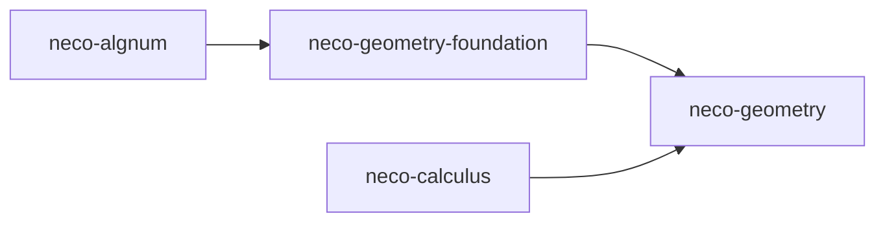

# neco-geometry

[English](README.md)

`neco-geometry` は、実代数的数を座標とする厳密な幾何計算を提供する Rust のクレート群です。点やベクトルなどの基礎的な値から、形状の宣言と評価、点が代数的領域の内部・境界・外部のどれに属するかの判定、交差の構成、代数的領域の境界の導出と次元ごとの分割までを扱います。

## クレート構成

- [`neco-geometry-foundation`](https://crates.io/crates/neco-geometry-foundation): 点、ベクトル、方向、直交変換、単位四元数、有理チャート ( chart、パラメータの有理式で座標を与える写像 ) の宣言
- [`neco-geometry`](https://crates.io/crates/neco-geometry): 媒介変数表示と陰関数表示の形状、厳密な値または包含区間による評価、代数的領域、交差集合、境界の導出と次元ごとの分割

## 依存関係



**外部依存クレート**

* [`neco-algnum`](https://docs.rs/neco-algnum): `neco-geometry-foundation` が利用する厳密な座標
* [`neco-calculus`](https://docs.rs/neco-calculus): `neco-geometry` が利用する包含区間の評価 ( 真の値を必ず含む区間を返す評価 ) と、根の存在の根拠

**本リポジトリを利用するリポジトリ**

* [`neco-cad`](https://github.com/barineco/neco-cad): 代数的領域から境界表現・テセレーション・メッシュを構成する Rust crates

## 関連リンク

* [基礎型の API 文書](https://docs.rs/neco-geometry-foundation)
* [幾何演算の API 文書](https://docs.rs/neco-geometry)
* [ソースリポジトリ](https://github.com/barineco/neco-geometry)

## ランタイム構成

既定の構成では、標準ライブラリを使います。

```toml
[dependencies]
neco-geometry = "0.2"
```

既定の `std` 機能を無効にすると、動的メモリ確保だけを前提に動作するため、標準ライブラリの無い環境でも使えます。

```toml
[dependencies]
neco-geometry = { version = "0.2", default-features = false }
```

## ライセンス

MIT License ( 詳細は [LICENSE](LICENSE) を参照 )
