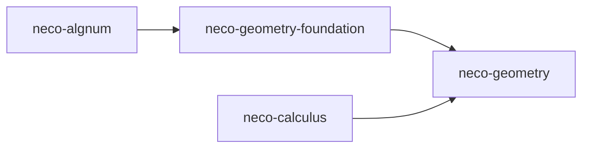

# neco-geometry

[日本語](README-ja.md)

`neco-geometry` is a suite of Rust crates providing exact geometric computation with real algebraic numbers as coordinates. It covers foundational values such as points and vectors, shape declaration and evaluation, classification of a point as interior, boundary, or exterior to an algebraic region, intersection construction, and the derivation of the boundary of an algebraic region and its split by dimension.

## Crates

* [`neco-geometry-foundation`](https://crates.io/crates/neco-geometry-foundation): Points, vectors, directions, orthogonal transformations, unit quaternions, and declarations of rational charts (maps that give coordinates as rational functions of a parameter).
* [`neco-geometry`](https://crates.io/crates/neco-geometry): Parametric and implicit shapes, evaluation as exact values or enclosing intervals, algebraic regions, intersection sets, and boundary derivation with the split by dimension.

## Dependencies



**External Dependencies**

* [`neco-algnum`](https://docs.rs/neco-algnum): Exact coordinates used by `neco-geometry-foundation`.
* [`neco-calculus`](https://docs.rs/neco-calculus): Enclosure evaluation (evaluation that returns an interval guaranteed to contain the exact value) and evidence for the existence of roots, used by `neco-geometry`.

**Repositories Using This Repository**

* [`neco-cad`](https://github.com/barineco/neco-cad): Rust crates that construct boundary representations, tessellation, and meshes from algebraic regions.

## Related Links

* [API Documentation for Foundation Types](https://docs.rs/neco-geometry-foundation)
* [API Documentation for Geometric Operations](https://docs.rs/neco-geometry)
* [Source Repository](https://github.com/barineco/neco-geometry)

## Runtime Configuration

The default configuration uses the standard library.

```toml
[dependencies]
neco-geometry = "0.2"
```

Disabling the default `std` feature leaves dynamic memory allocation as the only runtime requirement, so the crates can be used in environments without the standard library.

```toml
[dependencies]
neco-geometry = { version = "0.2", default-features = false }
```

## License

MIT License (see [LICENSE](LICENSE) for details)
